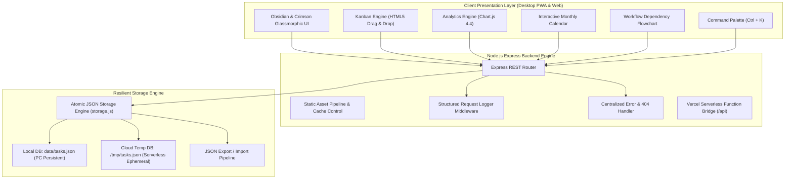
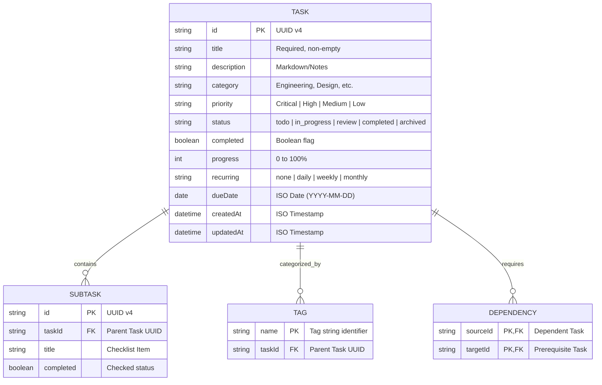
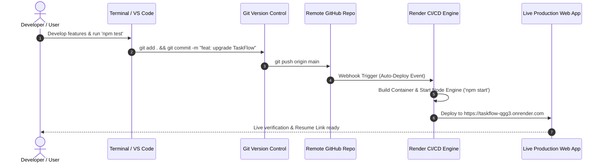

# ⚡ TASKFLOW PROTOCOL // v2.5 PRO
> An enterprise-grade, high-performance Task & Project Orchestration Platform built with **Node.js** and **Express**. Engineered with a dark obsidian & vibrant crimson design language, multi-view execution matrix (Kanban, List, Analytics, Calendar, Timeline, Workflow Flowchart), and instant keyboard-driven command palette.

[](https://taskflow-qgg3.onrender.com)
[](https://nodejs.org/)
[](https://expressjs.com/)
[]()
[](LICENSE)

---

## 🌐 Live Deployment & Resume Links

- **Live Production URL:** [https://taskflow-qgg3.onrender.com](https://taskflow-qgg3.onrender.com)
- **GitHub Repository:** [https://github.com/rafiulshafin/mini-project](https://github.com/rafiulshafin/mini-project)
- **Target Role Portfolio Item:** Full-Stack Node.js Developer / Systems Engineer

---

## 📸 System Overview & UI Previews

```text
+---------------------------------------------------------------------------------------------------+
|  ⚡ TASKFLOW v2.5 PRO    [ ⌘ Command Palette / Search (Ctrl + K) ]    23:15:00 UTC   [+ New Task] |
+---------------------------------------------------------------------------------------------------+
|  [ VELOCITY: 94.8% ▲+12% ]       [ ACTIVE SPRINT: SPRINT 42 ]       [ DEADLINE RADAR: 0 ALERTS ]  |
+---------------------------------------------------------------------------------------------------+
|  [ 📋 Kanban Board ] [ 📑 Task List ] [ 📊 Analytics ] [ 📅 Calendar ] [ ⏱️ Timeline ] [ 🕸️ Flow ]|
+---------------------------------------------------------------------------------------------------+
|                                                                                                   |
|  [ TO DO (2) ]          [ IN PROGRESS (1) ]       [ IN REVIEW (1) ]         [ DONE (4) ]          |
|  +--------------------+ +-----------------------+ +-----------------------+ +-------------------+ |
|  | Build REST API     | | TaskFlow Next-Gen     | | Architecture Audit    | | Daily Cardio 30m  | |
|  | 🔴 Critical        | | 🟠 High Priority      | | 🟡 Medium Priority    | | 🟢 Low Priority   | |
|  | #Backend #NodeJS   | | #Platform #v2.5       | | #SecOps #Compliance   | | #Habit #Wellness  | |
|  | Due: 2026-11-25    | | Due: 2026-11-21       | | Due: 2026-11-24       | | Completed 100%    | |
|  +--------------------+ +-----------------------+ +-----------------------+ +-------------------+ |
+---------------------------------------------------------------------------------------------------+
```

---

## 🏗️ System Architecture & Workflow



---

## 🗄️ Entity Relationship (ER) Data Model



---

## 🔄 Project Lifecycle & Pull Request (PR) Workflow



---

## ✨ Core Features & Technical Highlights

### 1. 🌌 Futuristic Ambient Hero & HUD
- **Canvas Particle Physics:** Lightweight 60fps canvas particle mesh with interactive drifting nodes and connecting lines.
- **HUD System Bar:** Real-time UTC/Local digital clock, system latency pulse (`SYS_ACTIVE`), notification center, and theme switcher.
- **Productivity Telemetry:** Real-time velocity index, active sprint tracker, and deadline radar.

### 2. 🗂️ Multi-Dimensional Task Visualizations
- **📋 Kanban Board:** Full drag-and-drop workflow across 4 stages (`To Do`, `In Progress`, `In Review`, `Done`) with real-time backend synchronization.
- **📑 Traditional List View:** Detailed list view with expandable subtask checklists, status badges, priority markers, and quick actions.
- **📊 Interactive Analytics & Charts:** Powered by **Chart.js 4.4**:
  - *Task Completion & Velocity Trend* (7-day created vs completed tasks over time).
  - *Status Distribution* (doughnut chart showing workflow stages).
  - *Category Performance* (task throughput across categories).
  - *Priority Matrix* (distribution by urgency).
  - *Activity Stream* (live audit log of recent changes).
- **📅 Interactive Calendar:** Full monthly view showing scheduled deadlines as clickable badges, month navigation, and click-to-schedule day cells.
- **⏱️ Timeline / Gantt View:** Linear visual tracking of task spans, progress percentage, and upcoming deadlines.
- **🕸️ Workflow Flowchart:** Interactive node graph visually connecting pipeline stages and task dependencies.
- **🗄️ Archived Tasks View:** Cold archival storage with 1-click restoration.

### 3. 🎯 Advanced Task Management & Pinning
- **📌 Pinned / Starred Tasks:** 1-click pin to lock critical priorities to the top of Kanban columns and List view with amber-obsidian glow.
- **Priorities:** `Critical` (🔴 neon glow), `High` (🟠), `Medium` (🟡), `Low` (🟢).
- **Subtasks & Progress Tracking:** Interactive checklist on cards and in the modal. Parent task progress (0%–100%) auto-calculates from completed subtasks.
- **🎨 Dynamic Neon Tag Matrix:** Deterministic color-coded tag pills for high-visibility visual categorization.
- **Recurring Tasks:** Native support for `Daily`, `Weekly`, `Monthly`, or `None`.
- **Duplicate & Archive:** 1-click task cloning and soft archival.

### 4. 🤖 AI Intelligence Suite (LLM Integration)
- **✨ AI Subtask Breakdown:** Generates 4–6 actionable, estimated subtasks from any task title and requirements.
- **🪄 AI Smart Polish:** Auto-structures titles, generates professional Markdown descriptions, detects urgency, and suggests relevant tags.
- **📊 AI Executive Sprint Briefing:** Generates an executive standup briefing analyzing sprint velocity, critical blockers, and actionable recommendations.
- **⚙️ Dual-Engine Resilience:** Integrates **Google Gemini 1.5/2.0 Flash API** with an intelligent built-in neural fallback engine so AI features always function seamlessly.

### 5. ⏱️ Focus Protocol (Integrated Pomodoro Timer)
- **Multi-Cadence Timer:** 25m Focus / 5m Break / 15m Rest intervals with live progress bar and countdown display.
- **Active Task Binding:** Click the `⏱️` button on any task card to bind the timer directly to that task.
- **🔔 Procedural Web Audio Alerts:** Synthesizes custom sci-fi chimes for task completions, creations, and timer completions using pure Web Audio API (zero audio file downloads, zero latency).

### 6. ⚡ Global Command Palette (`Ctrl + K` / `⌘K`) & Data Portability
- Instant fuzzy search across tasks, tags, and notes.
- Quick command actions: Switch viewports, trigger AI sprint briefing, launch Pomodoro timer, toggle sound effects, export CSV/JSON backups, and trigger print/PDF layout.
- **📊 CSV & JSON Export:** Full database backup download in JSON or spreadsheet-ready CSV format.
- **🖨️ PDF & Print Engine:** Custom `@media print` stylesheets optimized for clean, professional paper and PDF export.

---

## 🚀 Getting Started: How to Clone & Run

### Prerequisites
- **Node.js** v20.0.0 or higher
- **npm** v9.0.0 or higher
- **Git**

### Installation & Local Setup

```bash
# 1. Clone the repository
git clone https://github.com/rafiulshafin/mini-project.git

# 2. Navigate to project root
cd mini-project

# 3. Install dependencies
npm install

# 4. Start the application
npm start
```

Open your browser at **[http://localhost:3000](http://localhost:3000)**.

### Development Mode (Auto-Reload on Change)
```bash
npm run dev
```

### Run Automated Tests
```bash
npm test
```
All **10/10** tests will execute using Node's built-in `node:test` runner.

---

## 🖥️ Running as a Desktop App on Windows

To run TaskFlow as a standalone desktop application (no browser address bar, exactly like YouTube/Spotify):

1. Double-click **`TaskFlow-App.bat`** (or use **`create-shortcut.vbs`** to generate a desktop icon).
2. It automatically starts the background server if not already running and launches in standalone app mode.

---

## ☁️ Cloud Deployment (Live on Render)

### Live Production Deployment (Render)
The application is live and hosted continuously on **Render**:
- **Production URL:** [https://taskflow-qgg3.onrender.com](https://taskflow-qgg3.onrender.com)
- **Runtime:** Node.js v20+
- **Build Command:** `npm install`
- **Start Command:** `npm start`
- **Continuous Deployment:** Synchronized automatically on every push to the `main` branch.

### Alternate Option: Deploying to Vercel
1. Push your repository to GitHub (`rafiulshafin/mini-project`).
2. Go to **[vercel.com](https://vercel.com)** and sign in with GitHub.
3. Switch to your **Personal (Hobby)** account (from the top-left workspace menu).
4. Click **"Add New Project"** ➔ Select `mini-project`.
5. Set Framework Preset to **Other**, leave Build & Output blank, and click **"Deploy"**.

---

## 📡 REST API Reference

| Method | Endpoint | Description |
| :--- | :--- | :--- |
| `GET` | `/api/health` | Health check, system uptime, and Node version |
| `GET` | `/api/tasks` | List tasks (supports `status`, `priority`, `category`, `tag`, `search`, `sortBy`) |
| `GET` | `/api/tasks/:id` | Get details for a single task |
| `POST` | `/api/tasks` | Create task (`title`, `description`, `category`, `priority`, `dueDate`, `tags`, `subtasks`, `recurring`) |
| `PUT` | `/api/tasks/:id` | Update full task specifications |
| `PATCH` | `/api/tasks/:id/toggle` | Fast completion toggle |
| `PATCH` | `/api/tasks/:id/pin` | Toggle pinned-to-top status |
| `POST` | `/api/tasks/:id/duplicate` | Clone task into a new instance |
| `PATCH` | `/api/tasks/:id/archive` | Toggle archival status |
| `POST` | `/api/tasks/:id/subtasks` | Add subtask checklist item |
| `PATCH` | `/api/tasks/:id/subtasks/:subtaskId` | Toggle subtask completed status |
| `DELETE` | `/api/tasks/:id/subtasks/:subtaskId` | Delete subtask item |
| `DELETE` | `/api/tasks/:id` | Delete task permanently |
| `GET` | `/api/tasks/export` | Download full database backup as JSON |
| `GET` | `/api/tasks/export/csv` | Download full database export as RFC 4180 CSV spreadsheet |
| `POST` | `/api/tasks/import` | Restore database backup |
| `GET` | `/api/stats` | Productivity telemetry, 7-day velocity, category breakdown, notifications |
| `POST` | `/api/ai/breakdown` | ✨ AI subtask decomposition (Gemini API / Neural Engine) |
| `POST` | `/api/ai/polish` | ✨ AI task title, description & tag enhancement |
| `POST` | `/api/ai/summary` | ✨ AI executive sprint briefing & velocity analysis |

---

## 📄 License
This project is licensed under the MIT License - see the [LICENSE](LICENSE) file for details.
